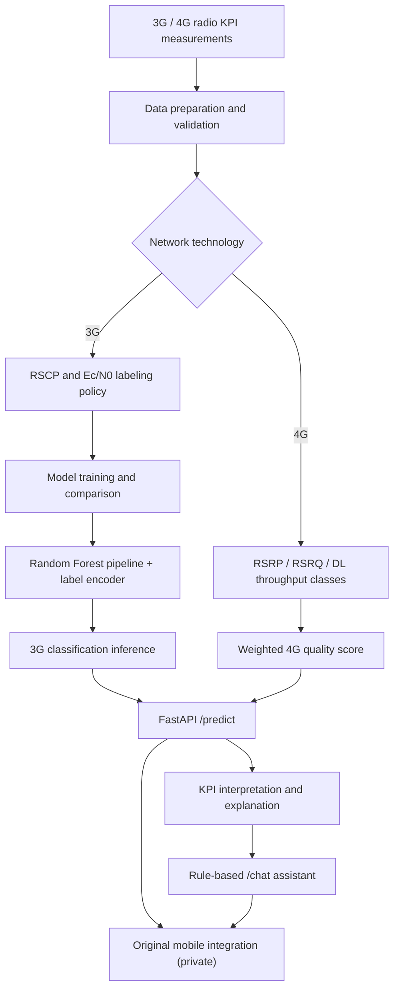

# Telecom QoS Intelligence — 3G Machine Learning & 4G Network Quality Assessment

**Radio Network Analytics · Supervised Machine Learning · KPI-Based Scoring · FastAPI**

[](https://github.com/MahdiBenHalima/Telecom-QoS-3G-4G-AI/actions/workflows/tests.yml)


A telecommunications engineering project for **assessing mobile network quality from radio measurements**. It combines a **Random Forest-based 3G classification workflow**, a transparent **4G KPI scoring engine**, and a **FastAPI inference service** with explainable results.

The system was developed as an academic project with a mobile-facing application. This public repository presents the **ML, radio-analysis and backend components** as a reproducible engineering portfolio, using fabricated test records instead of distributing original measurement datasets.

## At a glance

| 3G quality classification | 4G network assessment | API & decision explanations |
| --- | --- | --- |
| Supervised ML on seven radio features | Weighted RSRP, RSRQ and downlink-throughput scores | REST inference endpoints and deterministic diagnostic assistant |
| Random Forest with Logistic Regression and Decision Tree comparisons | Explicit 30% / 30% / 40% weighting | FastAPI, Pydantic, unit/API tests and GitHub Actions |
| Reproducible preprocessing, training and model export | No model training required for 4G scoring | The original application also included a Flutter client |

## Engineering problem

Mobile-network measurements include many radio indicators, but individual KPI values are not always easy to interpret. This project turns selected **3G and 4G radio measurements** into a consistent, inspectable quality assessment to support technical interpretation.

The two networks use different methods:

- **3G:** a supervised classifier learns to reproduce QoS categories **derived from RSCP and Ec/N0 thresholds**.
- **4G:** a deterministic scoring policy combines **RSRP, RSRQ and downlink throughput**.

The output is an interpretable connection recommendation with supporting KPI classifications. The result represents the project's engineering assessment rules, **not an independently validated subscriber Quality of Experience (QoE) or operator SLA**.

## System architecture



The 3G model artifacts are generated locally from an authorized dataset; they are **not bundled** in this repository. The **4G API works without any trained model**.

## 1. 3G — Machine learning pipeline

### Input features

The reconstructed training pipeline uses the following **seven radio features** from the original training schema:

| Feature | Description |
| --- | --- |
| `band_active` | Active 3G frequency band |
| `channel_active` | Active channel number |
| `scrambling_active` | Active scrambling code |
| `rscp_active` | Received signal code power (active cell) |
| `ecno_active` | Energy-per-chip to noise density ratio |
| `rscp_detected` | RSCP of a detected cell |
| `scrambling_detected` | Detected-cell scrambling code |

### Feature engineering and quality labels

The original procedure scores the two core KPIs separately and combines them:

```text
3G QoS score = 0.50 × RSCP class score + 0.50 × Ec/N0 class score
```

| Composite score | Derived connection category |
| --- | --- |
| ≥ 3.2 | Connexion recommandée |
| ≥ 2.2 and < 3.2 | Connexion possible mais instable |
| < 2.2 | Connexion faible / non recommandée |

These classes are **engineered targets based on the input KPIs**, not independent ground-truth measurements of customer experience. Classification metrics therefore describe agreement with the labeling policy.

### Training and model comparison

The public training reconstruction includes:

1. Parsing the original-style, semicolon-separated 3G measurement format.
2. Cleaning fields, normalizing numeric values and removing invalid core KPI records.
3. Engineering the RSCP/Ec/N0-based classification target.
4. Preprocessing with `ColumnTransformer`, imputation, scaling and one-hot encoding.
5. A **stratified 80/20 train–test split** with random seed `42`.
6. Comparing **Logistic Regression, Decision Tree and Random Forest** using accuracy and weighted F1.
7. Fitting the final **Random Forest with 200 estimators and balanced class weights** on the filtered dataset for local export.

**Implementation:** [`training/train_3g.py`](training/train_3g.py) · [Reproduction notebook](notebooks/reproduce_3g_training.ipynb)

### Experiment evidence

| Experiment setting | Value verified in source |
| --- | --- |
| Feature count | 7 |
| Target | Three QoS categories derived from RSCP and Ec/N0 |
| Evaluation split | 80% train / 20% test, stratified |
| Baselines | Logistic Regression, Decision Tree |
| Exported model | Random Forest, 200 trees, `class_weight="balanced"` |
| Evaluation metrics produced by training | Accuracy, weighted F1 |
| Published real-dataset test metrics | **Not included**; cannot be verified without the authorized source dataset |

Running the reconstruction with permitted data writes `evaluation_3g.json`, including the local results. No synthetic-test accuracy is presented here as a real-world network-performance metric.

## 2. 4G — KPI-based network quality scoring

The 4G analysis uses three radio indicators. Their categories are converted into ordinal scores and aggregated with the following explicit weights:

| KPI | Weight | Role |
| --- | ---: | --- |
| **RSRP** | **30%** | Received reference signal power |
| **RSRQ** | **30%** | Reference signal quality |
| **Downlink throughput** | **40%** | Download performance |

```text
4G QoS score = 0.30 × RSRP score
             + 0.30 × RSRQ score
             + 0.40 × Downlink throughput score
```

| Global score | Connection recommendation |
| --- | --- |
| ≥ 3.5 | Connexion recommandée |
| ≥ 2.3 and < 3.5 | Connexion possible mais instable |
| < 2.3 | Connexion faible / non recommandée |

### Reproducible 4G example

<details>
<summary><strong>Example input and calculated result</strong></summary>

```json
{
  "network_type": "4G",
  "rsrp": -86,
  "rsrq": -9,
  "throughput_dl": 22
}
```

The implemented classification rules produce:

| KPI | Class | Score |
| --- | --- | ---: |
| RSRP = −86 | Bonne | 3 |
| RSRQ = −9 | Acceptable | 3 |
| Throughput = 22 | Assez bien | 3 |

```text
Global score = 0.30 × 3 + 0.30 × 3 + 0.40 × 3 = 3.0
Decision     = Connexion possible mais instable
```

</details>

This is a **deterministic calculation**, not an ML prediction or result measured from a live operator network.

**Implementation:** [`backend/services/predictor_4g.py`](backend/services/predictor_4g.py)

## 3. FastAPI — Inference and explanations

The backend exposes inference and technical explanation services through FastAPI.

| Method | Endpoint | Description |
| --- | --- | --- |
| `GET` | `/` | API status and 3G model availability |
| `POST` | `/predict` | 3G Random Forest inference or 4G KPI scoring |
| `POST` | `/chat` | Rule-based explanation of radio quality and weak KPIs |

The diagnostic assistant relies on predefined technical rules and **does not use an LLM or RAG**.

### Run locally

**Requirements:** Python 3.11 recommended.

```bash
git clone https://github.com/MahdiBenHalima/Telecom-QoS-3G-4G-AI.git
cd Telecom-QoS-3G-4G-AI
python -m venv .venv
```

Activate the environment:

- **Windows PowerShell:** `.venv\Scripts\Activate.ps1`
- **Linux/macOS:** `source .venv/bin/activate`

```bash
python -m pip install -r requirements.txt
uvicorn backend.main:app --reload
```

Open **http://127.0.0.1:8000/docs** to explore the API interactively.

### Example: 4G API request

```bash
curl -X POST "http://127.0.0.1:8000/predict" \
  -H "Content-Type: application/json" \
  -d '{"network_type":"4G","rsrp":-86,"rsrq":-9,"throughput_dl":22}'
```

The response includes KPI classes, individual scores, a global score of **3.0**, a connection recommendation and a generated explanation. Additional optional fields include zone and frequency band information.

> **3G inference:** `/predict` returns HTTP `503` when local trained model artifacts are unavailable. Train and export the pipeline before using 3G inference.

### Reproduce the 3G training

With an **authorized local copy** of the original-style `DT2.csv`:

```bash
python -m training.train_3g --data "/path/to/authorized/DT2.csv" --output backend/models
```

The command exports:

```text
backend/models/
├── rf_3g_pipeline.joblib
├── label_encoder_3g.joblib
└── evaluation_3g.json
```

Do not load untrusted `joblib`/pickle files; deserializing them can execute arbitrary code.

## 4. Verification and engineering quality

The public repository includes automated tests and an operational GitHub Actions workflow.

| Validation area | What the tests check |
| --- | --- |
| **3G data & ML** | KPI-derived label boundaries, source-format processing, synthetic training and artifact export |
| **4G assessment** | KPI categorization, weighted scoring and decision thresholds |
| **FastAPI** | Prediction contract, required input validation and response behavior |
| **Diagnostic assistant** | Deterministic KPI explanation logic |
| **CI** | Dependency installation and `pytest` on Python 3.11 |

```bash
python -m pytest -q
```

[View GitHub Actions](https://github.com/MahdiBenHalima/Telecom-QoS-3G-4G-AI/actions) · [Methodology and reproducibility](docs/REPRODUCIBILITY.md)

**Validation scope:** These checks use fabricated input records and verify the software's behavior. They are not evidence of generalization across real cells, field conditions or independent QoE labels.

## 5. Project structure

```text
Telecom-QoS-3G-4G-AI/
├── backend/
│   ├── core/model_loader.py
│   ├── schemas/
│   ├── services/
│   │   ├── predictor_3g.py
│   │   ├── predictor_4g.py
│   │   ├── explanation_service.py
│   │   └── chat_service.py
│   └── main.py
├── training/train_3g.py
├── notebooks/reproduce_3g_training.ipynb
├── tests/
├── docs/
│   ├── REPRODUCIBILITY.md
│   └── SECURITY_AND_DATA.md
├── .github/workflows/tests.yml
├── TRACEABILITY.md
├── requirements.txt
└── README.md
```

## 6. Technology stack

| Area | Technologies |
| --- | --- |
| **Machine learning** | Python, pandas, NumPy, scikit-learn, Random Forest, Logistic Regression, Decision Tree |
| **Model engineering** | ColumnTransformer, Pipeline, LabelEncoder, joblib |
| **API services** | FastAPI, Pydantic, Uvicorn |
| **Validation and reproducibility** | pytest, GitHub Actions, Jupyter Notebook |
| **Telecom** | 3G RSCP / Ec/N0; 4G RSRP / RSRQ / downlink throughput |
| **Full original application** | Flutter mobile integration (not part of this public AI repository) |

## 7. Public release and technical boundaries

This repository presents the **AI and radio-quality assessment work** from a larger academic project. Original measurement datasets, trained model artifacts, local configurations and the Flutter application are not distributed here.

The 3G model learns **labels derived from its input KPIs**, so conventional classification metrics must not be interpreted as independently validated service quality. The 4G module is a **weighted engineering score**, not a trained 4G model. The assistant is **rule-based**, not generative AI.

Reliable use in an operator environment would additionally require independent QoE ground truth, cell- or time-aware evaluation, monitoring, security review and appropriate calibration. See [data and security considerations](docs/SECURITY_AND_DATA.md) and [source traceability](TRACEABILITY.md).

---

**Author:** [Mahdi Ben Halima](https://github.com/MahdiBenHalima) · ENET'Com — Telecommunications Engineering

**Focus:** Applied Machine Learning · Mobile Network KPIs · Radio Quality Assessment · Model Deployment · Reproducible Engineering
